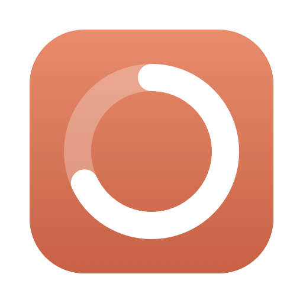
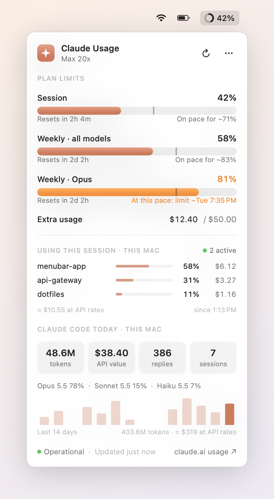

<div align="center">



# ClaudeBar

**Your Claude plan limits, one glance away.**

A tiny native macOS menu bar app that shows your Claude session and weekly usage,
predicts when you'll hit a limit, shows what's using it up and what it would cost
at API prices, and flags Anthropic incidents.


<picture>
  <source media="(prefers-color-scheme: dark)" srcset="docs/screenshot-dark.png">
  
</picture>

</div>

## Features

- **Live plan limits.** Session (5-hour), weekly, and per-model weekly limits, each with
  a reset countdown. These are the same numbers as `/usage` in Claude Code and the usage page on claude.ai.
- **Pace prediction.** The tick on each bar marks how much of the window has passed. If
  the fill is past the tick, you're using it faster than an even pace. ClaudeBar projects
  where you'll land by the reset, or tells you roughly when you'll hit the limit.
- **Menu bar gauge.** A ring plus a percentage that turns red from 90%. You can show the
  session, session and weekly, or just the icon.
- **What's using your limit.** Each project's share of the current session window, from
  your Claude Code usage on this Mac. The shares are weighted by cost, not raw tokens, because
  limits track compute and cheap cache reads would otherwise dominate.
- **API cost estimate.** What your Claude Code usage would cost at pay-as-you-go API prices,
  for the session window, today, and the last 14 days. This shows what your subscription is worth.
- **Anthropic status.** A banner and a menu bar badge when status.claude.com reports a problem
  with claude.ai, the API or Claude Code. Incidents affecting other products only get a quiet
  footer note.
- **Alerts** at 80% and 95% of any limit, once per reset window.
- **Extra usage**: overage credits spent against your monthly cap.
- **Claude Code on this Mac**: today's tokens, output, replies and sessions, how many
  sessions are active right now, the model mix, a 14-day chart and your busiest projects.
- **Tiny and native.** SwiftUI, no dependencies, no analytics, about 1 MB. It launches at
  login if you want it to.

## Install

### Download

1. Get `ClaudeBar-vX.Y.Z.zip` from the [latest release](../../releases/latest) and unzip it.
2. Move `ClaudeBar.app` to `/Applications` (or `~/Applications`).
3. The app is ad-hoc signed, not notarised, so macOS blocks it on first launch. Either
   right-click the app → **Open**, or run:
   ```sh
   xattr -dr com.apple.quarantine /Applications/ClaudeBar.app
   ```

### Build from source

Requires Xcode 16+ (Swift 6).

```sh
git clone <this repository>
cd claude-usage-bar
make install   # builds ClaudeBar.app, copies it to ~/Applications and launches it
```

## Requirements

- macOS 15 Sequoia or later, on Apple silicon or Intel.
- [Claude Code](https://claude.com/claude-code), signed in with a Claude subscription
  (Pro, Max, Team or Enterprise). ClaudeBar reuses that login, so there's nothing to
  configure. If you use Claude Code with an API key only, you'll still get the local
  activity stats, but not plan limits.

## How it works

| What | Where it comes from |
| --- | --- |
| Plan limits, extra usage | `GET https://api.anthropic.com/api/oauth/usage`, polled every 3 minutes and whenever you open the popover |
| Plan name, organisation | Claude Code's stored credentials and `GET /api/oauth/profile` (fetched once per launch) |
| Claude Code activity | Session transcripts in `~/.claude/projects/**/*.jsonl`, rescanned every minute |
| API cost estimate | Token counts from those transcripts × the [published API prices](https://platform.claude.com/docs/en/about-claude/pricing), built into `Pricing.swift` |
| Service status | `GET https://status.claude.com/api/v2/summary.json` (public, no credentials), every 5 minutes |

The transcript scanner tails files incrementally. After the first scan it only reads bytes
appended since the previous one, so it stays cheap even with hundreds of megabytes of history.
Each response is counted once, even though Claude Code logs it once per content block.
"Tokens" counts input, output, cache writes and cache reads.

### What the estimates do and don't cover

- **API value** prices input, output, cache reads, and 5-minute and 1-hour cache writes at each
  model's list price. It includes the fast-mode and Haiku long-context rates, but not batch
  discounts or the US-only routing surcharge. Models without a known price are left out, and
  the tile is marked with `*`.
- **"Using this session"** only sees Claude Code on this Mac. Chats on claude.ai, other
  devices and other tools count toward the same limit but aren't visible here, so the shares
  are relative to what this Mac used. If plan limits can't be loaded, the section falls back
  to the last 5 hours.

## Privacy & security

- **Your token stays where it is.** ClaudeBar reads Claude Code's OAuth token from the
  login keychain (item `Claude Code-credentials`) through `/usr/bin/security`, the same tool
  that stored it, so macOS doesn't prompt. If that item doesn't exist, it falls back to
  `~/.claude/.credentials.json`.
- **It never refreshes or writes the token.** Rotating the refresh token would sign Claude Code
  out. When the token expires, ClaudeBar waits for Claude Code to refresh it.
- **The token goes only to `api.anthropic.com`.** The only other request is a public, unauthenticated
  fetch of `status.claude.com`, which you can turn off. There are no analytics and no update checks.
- **Transcripts are parsed locally** and nothing from them leaves your Mac.

## Settings

Open the popover and click **⋯**:

- **Menu bar shows**: session %, session and weekly %, or the icon only.
- **Alerts at 80% and 95%**: system notifications, once per limit and reset window.
- **Show Anthropic status**: the incident banner, footer status and menu bar badge.
- **Launch at login**
- **Quit** (⌘Q)

## Troubleshooting

| Banner | Fix |
| --- | --- |
| *Not signed in to Claude Code* | Run `claude`, then `/login` with your Claude account. |
| *Login token expired* | Run any Claude Code command so it refreshes its token, then press ↻. |
| *Rate limited by Anthropic* | ClaudeBar backs off automatically. Avoid hammering ↻. |
| *Unexpected usage response* | The undocumented API may have changed. Please [open an issue](../../issues/new/choose). |

If the API value looks off after Anthropic changes prices, the table in
`Sources/ClaudeBar/Pricing.swift` needs updating. PRs are welcome.

If notifications don't appear, allow them for ClaudeBar in **System Settings → Notifications**.

## Development

```sh
make test         # Swift Testing suite: parsing, pace maths, transcript scanner
make run          # run from the terminal
make app          # build build/ClaudeBar.app
make screenshots  # re-render docs/screenshot-*.png from demo data
make icon         # regenerate Resources/AppIcon.icns
```

`ClaudeBar --snapshot out.png [--dark] [--demo [--incident]]` renders the popover to an image
without the menu bar. It's handy for checking layout changes. Tagging `vX.Y.Z` builds a universal binary
and publishes a GitHub release. See [CONTRIBUTING.md](CONTRIBUTING.md) for how the code is
organised.

## Disclaimer

ClaudeBar is an unofficial community project. It is not affiliated with, endorsed by, or
supported by Anthropic. It relies on an undocumented endpoint that Claude Code uses
internally, which may change or disappear without notice. "Claude" is a trademark of Anthropic, PBC.

## License

[MIT](LICENSE) © 2026 Nurettin Coban
